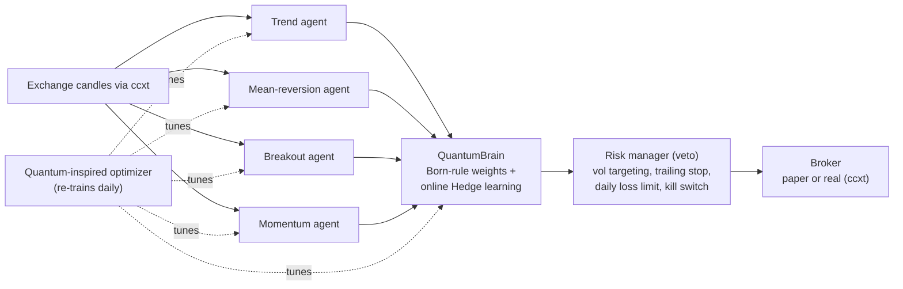

# QuantumBrain: a multi-agent crypto trading bot

Four trading agents, a meta-agent "brain" that learns which of them to trust, a
quantum-inspired optimizer that tunes everything, and a risk manager with veto power.
It trades by itself, 24/7, starting from a $50 account. It paper-trades by default
and only sends real orders after you explicitly opt in.

## Read this first: honest expectations

* **No bot can guarantee profits, let alone "massive daily profits".** Anyone who
  promises that is selling something. This bot's goal is disciplined, risk-controlled
  trading that you can measure. It is not a money printer.
* **$50 is a hard place to start.** Every trade pays a fee (0.40% at Kraken's lowest
  tier, about 0.10% at Binance/OKX), and exchanges reject orders under about $5–10.
  Even a *good* result of 2% a month turns $50 into about $63 after a year.
* **Mining 1 BTC in 10 days is not possible with normal hardware.** Run
  `qbrain mine-calc`: with live network data it needs about 210 PH/s, which is about 777 top-end
  ASIC miners, 2.8 MW of power and about $2.3M of hardware. A laptop CPU would take
  more than 100 million years. So this repo includes a mining *calculator*, not a
  miner. "1 BTC in 10 days" offers are scams.
* **"Quantum" here means quantum-*inspired*.** The optimizer is a real, published
  algorithm (QIEA, Han & Kim 2002) that runs on a normal computer. No quantum
  computer is involved, and none would help.

## Latest results (real data, fees included)

Walk-forward test on Bitstamp 4h candles, May 2025 to Sept 2026. The brain was tuned
on the first 70% only, then graded on the last ~150 days, which it never saw. The
test assumes $50 split across BTC and ETH, 0.40% fees and 5 bps slippage.

| Out-of-sample (Apr 26 to Sep 23, 2026) | BTC sleeve | ETH sleeve | Portfolio |
|---|---|---|---|
| QuantumBrain return | **+1.1%** | **−1.7%** | **−0.3%** ($50.00 → $49.85) |
| Buy & hold return | +7.0% | +12.5% | +10.2% |
| QuantumBrain worst drawdown | 3.8% | 4.6% | |
| Buy & hold worst drawdown | 29.4% | 36.0% | |
| Trades / win rate | 9 / 75% | 17 / 20% | |

Plain reading: in this period the bot **did not beat simply holding**. It spent most
of its time in cash, and it avoided the 30%+ drops that holders went through. The
untuned brain lost 6–8% on the same data, so the tuning helps, but no edge has been
proven yet. Re-run `qbrain backtest` yourself; the numbers change with the market.

## How it works



| Agent | Style | Signal |
|---|---|---|
| `trend` | EMA crossover | exposure grows with the fast/slow EMA gap, measured in ATRs |
| `mean_reversion` | buy the dip | enter when Bollinger z-score and RSI are both oversold, exit at the mean |
| `breakout` | turtle / Donchian | buy a new N-bar high, exit on a new M-bar low |
| `momentum` | time-series momentum | volatility-scaled return over a lookback window |

**The brain** gives each agent an amplitude *a*. Its prior trust is *a²/Σa²* (the Born
rule). Every bar it re-weights agents by how their signals would have performed
recently (the multiplicative-weights/Hedge algorithm). Agents that suit the current
market gain influence, and the rest fade. The final position is the weighted vote. It
opens only above a conviction threshold and closes only below half of it
(hysteresis, so it doesn't whipsaw).

**The quantum-inspired optimizer** encodes all 18 parameters (agent settings,
amplitudes, learning rate, memory, conviction) as Q-bits. It measures a population,
scores each candidate, rotates the Q-bits toward the best solutions and uses
NOT-gate mutations and superposition resets to escape local optima. Its objective is
Sharpe ratio minus a drawdown penalty, net of fees, and it discounts results backed
by only a handful of trades.

**The risk manager** always has the last word:
* volatility targeting: smaller positions when the market is wild
* exposure cap of 95% per sleeve
* ATR trailing stop, followed by a cooldown
* daily loss limit: flat for the rest of the UTC day after −6%
* **kill switch**: after a 25% drawdown from the peak, it stays in cash until you
  delete its state file (`state/paper_state.json` or `state/live_state.json`)
* rebalance band and minimum order size, so it doesn't bleed fees on tiny adjustments

## Quick start

```bash
pip install -e ".[dev]"
cp config.example.json config.json      # optional; defaults match this file

qbrain backtest              # walk-forward test on real history (downloads candles)
qbrain backtest --synthetic  # same, offline, on generated data
qbrain run                   # paper-trade 24/7 on live prices
qbrain status                # balances, fees and P&L
qbrain mine-calc             # what a mining rig really earns
qbrain mine-calc --rig cpu   # ...and why a laptop can't mine Bitcoin
pytest                       # 37 tests, fully offline
```

`qbrain run` trains a brain per symbol on the first start, re-trains it every 24h,
acts once per closed 4h candle and saves everything to `state/`, so it resumes
after a restart. To run it continuously:

```bash
nohup qbrain run >> state/console.log 2>&1 &        # simplest
# or process one candle per call from cron, a few minutes after each 4h close:
# 5 */4 * * *  cd /path/to/repo && qbrain run --once
```

## Going live with real money (only after weeks of paper trading)

1. Create an exchange API key with **trade permission only. Never enable
   withdrawals.** Restrict it to your server's IP if the exchange allows.
2. Fund the account with the amount you are prepared to lose ($50).
3. Set the environment and start:
   ```bash
   export QBRAIN_API_KEY=...  QBRAIN_API_SECRET=...
   export QBRAIN_I_ACCEPT_THE_RISK=yes
   qbrain run --real-money
   qbrain status --real-money
   ```
4. If you use Binance or OKX (about 0.10% fees), set `exchange`, `symbols` (for example
   `BTC/USDT`) and `fee_rate: 0.001` in `config.json`. Check that crypto trading and
   the exchange are legal where you live, and keep records for taxes.

## Configuration

All settings live in `config.json` (see `config.example.json`). The most important:

| Key | Default | Meaning |
|---|---|---|
| `exchange` / `data_exchange` | `kraken` / `bitstamp` | where orders go / where long backtest history comes from |
| `symbols` | `BTC/USD`, `ETH/USD` | capital is split equally across them |
| `timeframe` | `4h` | slower bars mean fewer trades and less fee drag |
| `starting_capital` | `50` | USD |
| `fee_rate` | `0.004` | per side; set it to your exchange's taker fee |
| `risk.max_drawdown` | `0.25` | kill-switch level |
| `risk.daily_loss_limit` | `0.06` | daily stop |
| `reoptimize_hours` | `24` | how often the brain re-trains |

## Project layout

```
qbrain/
  agents.py      the four trading agents
  brain.py       QuantumBrain: Born-rule weights + online Hedge learning
  quantum.py     quantum-inspired evolutionary optimizer (QIEA)
  optimize.py    training objective and walk-forward validation
  risk.py        volatility targeting and the RiskGuard (stops, limits, kill switch)
  broker.py      per-symbol ledgers; paper broker and real ccxt broker
  backtest.py    event-driven backtester (same path as live)
  live.py        24/7 runner with state persistence and daily re-training
  mining.py      Bitcoin mining profitability calculator
  data.py        ccxt candles, CSV cache, synthetic data
  cli.py         the `qbrain` command
docs/RESEARCH.md the 10-project shortlist and what was borrowed from each
tests/           37 offline tests (look-ahead, fees, risk rules, live runner...)
```

## Disclaimer

This is educational software, not financial advice. Crypto is extremely volatile. You
can lose everything you put in, and backtests, including the ones above, do not
predict future results. You are responsible for your own trades and for following
the law and tax rules where you live.
